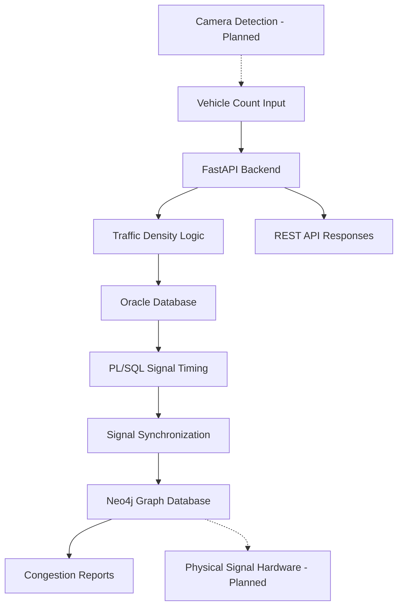

# 🚦 Intelligent Traffic Signal Controller

An adaptive traffic signal management system that uses vehicle-count data to estimate road congestion and recommend signal timings. The project combines **FastAPI, Oracle PL/SQL, and Neo4j** to demonstrate traffic-data processing, relational database programming, graph-based road relationships, and signal synchronization.

## Overview

Traditional traffic signals often use fixed timings regardless of traffic conditions. This project explores an adaptive approach in which vehicle-count readings are classified into traffic-density levels and used to determine recommended green-light durations.

The backend exposes REST APIs for managing junctions, roads, cameras, vehicle counts, signal timings, congestion reports, and simulated emergency priority.

## Features

- **Adaptive traffic logic:** Classifies traffic as LOW, MEDIUM, or HIGH based on vehicle count.
- **Dynamic timing recommendations:** Recommends green-light durations based on density.
- **Oracle PL/SQL integration:** Uses database functions and procedures to calculate density and update signal timing.
- **Neo4j graph model:** Represents junctions, roads, cameras, vehicle counts, and signals through graph relationships.
- **REST API:** Provides endpoints through FastAPI, with interactive Swagger documentation.
- **Congestion reporting:** Retrieves the latest recorded vehicle-count reading for each camera.
- **Emergency priority simulation:** Applies a configurable green-light duration and synchronizes the simulated signal state across both databases.
- **Automated tests:** Covers traffic logic, API validation, emergency-priority behavior, synchronization, and Oracle connectivity.

## Technology Stack

| Technology | Purpose |
|---|---|
| Python | Backend application and traffic logic |
| FastAPI | REST API framework |
| Oracle Database | Relational storage and PL/SQL processing |
| Neo4j | Graph database for traffic network relationships |
| Pydantic | Request validation and response schemas |
| Pytest | Automated testing |
| OpenCV / YOLO | Planned camera-based vehicle detection |

## Architecture



Oracle is used for relational data and PL/SQL-based signal timing. Neo4j represents relationships between the traffic-network entities. The backend coordinates operations between the two databases.

## Data Model

The project uses five core entities:

- **Junction:** A traffic intersection.
- **Road:** A road connected to a junction.
- **Camera:** A camera associated with a road.
- **VehicleCount:** A recorded vehicle count, timestamp, and density.
- **Signal:** A traffic signal controlled by a junction.

### Neo4j relationships

```text
(Junction)-[:HAS_ROAD]->(Road)
(Road)-[:HAS_CAMERA]->(Camera)
(Camera)-[:RECORDS]->(VehicleCount)
(Junction)-[:CONTROLS]->(Signal)
```

### Oracle relational schema

The relational schema uses the following tables:

- `JUNCTION`
- `ROAD`
- `CAMERA`
- `VEHICLECOUNT`
- `SIGNAL`

Primary keys and foreign keys maintain the relationships between these tables.

## Traffic Logic

The current Python traffic service uses the following rules:

| Vehicle count | Density | Recommended green time |
|---:|---|---:|
| 0–30 | LOW | 20 seconds |
| 31–60 | MEDIUM | 40 seconds |
| Above 60 | HIGH | 60 seconds |

Negative vehicle counts are rejected.

These thresholds and durations are configurable project logic for demonstration purposes, not validated timings for real-world traffic deployment.

## API Endpoints

Start the backend and open `/docs` for interactive API testing.

| Method | Endpoint | Purpose |
|---|---|---|
| GET | `/junctions` | List junctions |
| GET | `/roads` | List roads |
| GET | `/cameras` | List cameras |
| GET | `/signals` | List signals |
| GET | `/vehicle-counts` | List recorded vehicle counts |
| POST | `/vehicle-counts` | Process and store a vehicle-count reading |
| GET | `/traffic/congestion-report` | Retrieve the congestion report |
| POST | `/signals/emergency-priority` | Simulate emergency signal priority |
| POST | `/signals/synchronize` | Synchronize signal timings from Oracle to Neo4j |

### Example: Submit a vehicle-count reading

**Request**

```http
POST /vehicle-counts
Content-Type: application/json
```

```json
{
  "camera_id": "C01",
  "vehicle_count": 45
}
```

**Illustrative response**

```json
{
  "camera_id": "C01",
  "vehicle_count": 45,
  "density": "MEDIUM",
  "recommended_green_time": 40
}
```

The backend also stores the reading and invokes Oracle-based signal-timing processing. The actual response reflects the API's configured response schema.

### Example: Simulate emergency priority

```http
POST /signals/emergency-priority
Content-Type: application/json
```

```json
{
  "junction_id": "J02",
  "green_time": 90
}
```

This updates the simulated signal timing in Oracle and synchronizes the result to Neo4j. It does **not** operate a physical traffic light.

## Project Structure

```text
traffic-signal-controller/
├── backend/
│   ├── app/
│   │   ├── api/          # FastAPI routes
│   │   ├── database/     # Oracle and Neo4j connections
│   │   ├── models/       # Request and response schemas
│   │   ├── services/     # Traffic and database services
│   │   ├── config.py
│   │   └── main.py
│   ├── tests/            # Automated tests
│   ├── requirements.txt
│   └── test_*.py
├── database/
│   ├── neo4j/            # Graph seed data
│   └── oracle/           # Tables, sample data, PL/SQL
├── detection/             # Vehicle-detection prototype
├── .gitignore
└── README.md
```

## Getting Started

### Prerequisites

Install or configure:

- Python 3.10 or newer
- Oracle Database with a configured pluggable database
- Neo4j
- Git

The example commands below assume the Oracle service is available at `localhost:1521/FREEPDB1` and Neo4j is running with credentials configured locally. Adjust the connection settings to match your environment.

### 1. Clone the repository

```bash
git clone https://github.com/Ayush-Ojha-Dev/Intelligent-Traffic-Signal-Controller.git
cd Intelligent-Traffic-Signal-Controller
```

### 2. Set up the Python environment

```bash
cd backend
python3 -m venv venv
source venv/bin/activate
pip install -r requirements.txt
```

### 3. Configure environment variables

Create a local `.env` file inside `backend/`. Add the variables expected by `app/config.py` and the database connection modules.

For example, use the following names only if they match the application's configuration:

```dotenv
NEO4J_URI=bolt://localhost:7687
NEO4J_USERNAME=neo4j
NEO4J_PASSWORD=replace_with_your_local_password

ORACLE_USER=system
ORACLE_PASSWORD=replace_with_your_local_password
ORACLE_DSN=localhost:1521/FREEPDB1
```

Check `app/config.py`, `app/database/neo4j.py`, and `app/database/oracle.py` for the exact variable names your local version expects. Never commit real credentials or share them publicly.

### 4. Prepare the databases

Use the SQL scripts in `database/oracle/` to create the relational tables, insert sample data, and create the PL/SQL functions and procedures. Review the scripts and execute them in the intended order for your Oracle environment.

Run `database/neo4j/seed.cypher` against your Neo4j database to create the graph's sample nodes and relationships.

### 5. Start the API

From the `backend/` directory:

```bash
uvicorn app.main:app --reload
```

Open:

- API root: http://127.0.0.1:8000/
- Interactive Swagger documentation: http://127.0.0.1:8000/docs

### 6. Run tests

From the `backend/` directory, with the virtual environment activated:

```bash
python -m pytest -v
```

Tests that check live Oracle connectivity require the Oracle database to be configured and running. API and service tests also use mocks where appropriate.

## Current Status

### Implemented

- FastAPI endpoints for traffic entities and reports
- Vehicle-count density classification and green-time recommendations
- Oracle PL/SQL signal-timing updates
- Neo4j graph relationships and signal records
- Emergency-priority simulation
- Oracle-to-Neo4j signal synchronization
- Automated unit and API tests

### Planned / Future Work

- Live camera integration and vehicle detection with OpenCV/YOLO
- Raspberry Pi or IR-sensor integration
- Physical traffic-light hardware control
- More advanced adaptive scheduling and real-world traffic validation
- More robust handling of partial failures across the two databases

**Important:** The current project is a software prototype. Camera detection, hardware integration, and physical signal control are not yet implemented as a complete live system. It should not be deployed to control real traffic without appropriate engineering, testing, and safety validation.

## Testing

The project has previously passed **26 automated tests** in the development environment, including traffic-logic tests, API tests, and an Oracle connectivity test. Results may vary depending on database availability and local configuration.

## Contributing

This is a student mini-project. Suggestions, bug reports, and improvements are welcome through GitHub issues and pull requests.

## Author

**Ayush Ojha**

GitHub: [Ayush-Ojha-Dev](https://github.com/Ayush-Ojha-Dev)

## License

No license has been added yet. Until a license is selected and committed, others should not assume the code is available for unrestricted reuse.